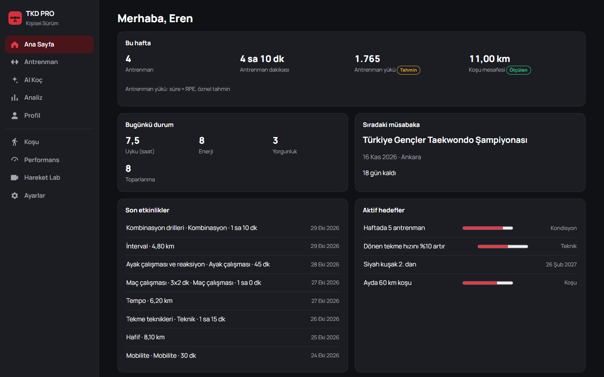
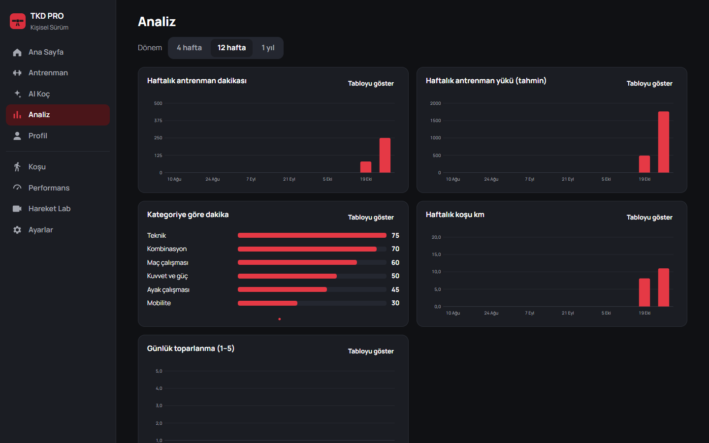

# TKD PRO — Personal Edition

**Train. Analyze. Evolve.**

A private, single-athlete Taekwondo (World Taekwondo Kyorugi) performance system for **Android and the
computer**, with the same data on both.

- **Phone:** the Android app (GPS runs, motion analysis, reaction tests), fully usable offline.
- **Computer:** `TKD-PRO.exe` runs the TKD PRO server on Windows and opens the web app in its own window.
  The web app (installable PWA) also works in any browser on the home network.
- **Sync:** two-way. Pair the phone once with a 6-digit code; changes made on either device appear on the other.

Turkish quick guide: [BILGISAYAR-VE-TELEFON.md](BILGISAYAR-VE-TELEFON.md). AI is off until the owner
enables it and chooses which data categories may be shared.

## Screenshots

| Home | Analysis |
|---|---|
|  |  |

*Web app (desktop / PWA) with sample training data.*

## What is in this repository

| Path | Contents |
|---|---|
| `app/` | Android app — Kotlin, Jetpack Compose, Material 3, MVVM, Hilt, Room, DataStore, WorkManager |
| `core/domain/` | Pure Kotlin business logic (GPS filtering, splits, best efforts, PRs, reaction stats, training load, pose kinematics, video quality, repetition segmentation) — unit tested on the JVM |
| `backend/` | FastAPI server (SQLite on the desktop, PostgreSQL in Docker): owner auth and device pairing, two-way sync, AI Coach proxy (OpenAI), server motion analysis (MediaPipe + OpenCV) |
| `backend/web/` | Web app / PWA served by the server — Home, Train, AI Coach, Insights, Profile, Running, Performance, Motion Lab, Settings |
| `desktop/` | `build-exe.ps1` builds `desktop/dist/TKD-PRO.exe` (server + web app in one file) |
| `docs/` | Architecture, setup, data model, roadmap, release checklist, licenses |

## Feature overview

- **Home dashboard** — greeting, date, local reminders, today, recovery, weekly volume, running, technical frequency, reaction, latest video analysis, upcoming competition, goals, AI weekly observations, recent activity. Cards can be hidden and reordered. Every card shows an empty state instead of fake numbers.
- **Training** — sessions (planned/completed, 10 categories, RPE, difficulty, notes), live technique-block recording with right/left tap counters and timer, technical library (15 built-in techniques + custom), technique history, combination builder with ordering, sides, demo video and practice history.
- **AI Motion Lab** — on-device MediaPipe Pose Landmarker (or your backend), video quality gate that refuses unreliable analysis and explains why, repetition segmentation, per-side joint-angle summaries with variability, keyframes, timeline charts, skeleton overlay on playback, left/right and two-recording comparison, optional AI interpretation. Measured facts, estimates and AI text are always labelled.
- **Match intelligence** — matches, rounds (attacks, successful attacks, defense, counters, notes), key moments linked to video timestamps, comparison with previous matches, user-maintained scoring presets (no hardcoded rules).
- **Running** — foreground-service GPS tracking with accuracy/duplicate/jump/jitter filtering, pause/resume segments, optional auto-pause, live pace/speed/elevation/splits, crash recovery, MapLibre map + offline route sketch, summaries, PRs from saved runs only, weekly/monthly analytics and a side-by-side comparison with Taekwondo training volume.
- **Performance lab** — visual, audio, random and repeated reaction tests with invalid-attempt filtering and disclosed conditions; balance (in-app stopwatch), tapping coordination, flexibility, jump (method required) and agility tests with progress charts.
- **Recovery** — daily check-in (sleep, quality, energy, fatigue, soreness, recovery, optional resting HR), 30-day trends and daily session-RPE load (labelled as an estimate).
- **AI Coach** — chat and weekly reports through your backend, using only permitted categories, with visible data sources and missing-data reporting.
- **Timeline & Insights** — unified, filterable development timeline; insights with week/month/custom ranges and previous-period comparison. No single unexplained score.
- **Profile & Settings** — private profile, belt history, goals, competitions; TR/EN language, system/light/dark theme, units, reminders, GPS preferences, app lock (biometrics/screen lock), AI permissions, backend & sync, JSON export, full data deletion.

## Quick start

See [docs/SETUP.md](docs/SETUP.md) for full instructions.

```bash
./gradlew :app:assembleDebug        # build the app
./gradlew :core:domain:test :app:testDebugUnitTest   # run tests
```

```bash
desktop/dist/TKD-PRO.exe                     # computer app (Windows); rebuild with desktop/build-exe.ps1
```

```bash
cd backend && docker compose up -d --build   # alternative: server on a VPS/home server with PostgreSQL
```

## Accuracy principles

- No fabricated statistics, GPS points, distances, records or measurements.
- Smartphone video is never used to claim kick force, impact speed, scoring validity or injury risk.
- Session load (duration × RPE) is labelled as a simple subjective estimate.
- Manual match observations are never shown as automatic detections.
- Running pace is not presented as a measure of fighting endurance.
- AI output is labelled, cites its data sources, and does not replace a coach or give medical advice.
